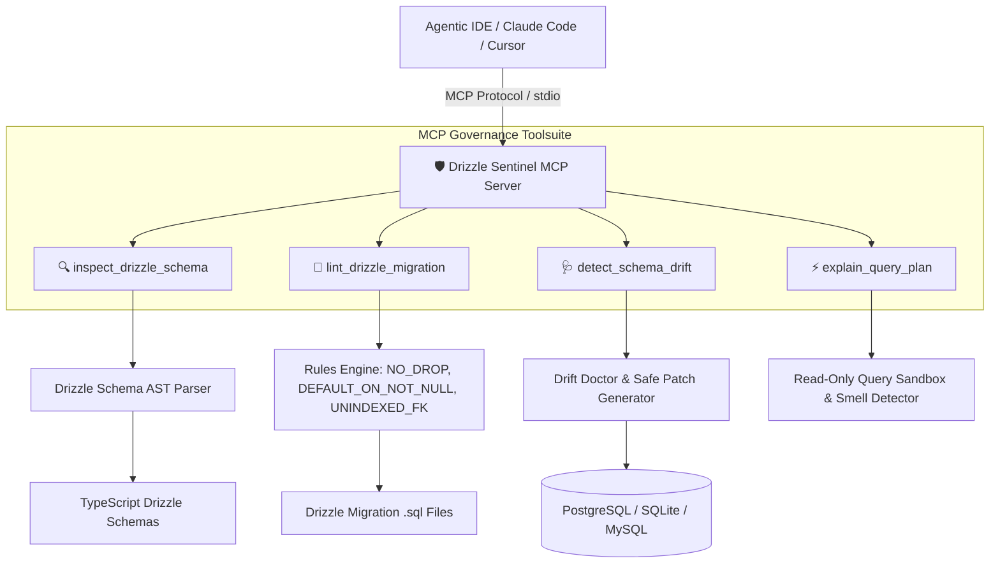

# 🛡️ Drizzle Sentinel MCP

> **Production-Grade TypeScript MCP Server for Drizzle ORM Schema Inspection, Migration Safety Linting, and Schema Drift Detection.**


---

## 🌟 Overview & Purpose

Autonomous coding agents (Claude Code, Cursor, Codex) frequently hallucinate or generate unsafe database migrations — such as adding `NOT NULL` columns without default values, dropping active columns, or forgetting indexes on foreign keys.

**Drizzle Sentinel MCP** is built for modern TypeScript engineering stacks (**Turborepo + Drizzle ORM + Express / Next.js**). It injects closed-loop database governance directly into agentic development workflows via the official Model Context Protocol.

---

## 🏗️ System Architecture



---

## 🛠️ MCP Tools Provided

1. **`inspect_drizzle_schema`**: Deeply analyzes TypeScript Drizzle schemas, mapping tables, relations, and identifying foreign keys lacking index coverage.
2. **`lint_drizzle_migration`**: Evaluates SQL migration statements against production safety rules:
   - `NO_RAW_DROP_TABLE`: Blocks destructive table drops.
   - `NO_RAW_DROP_COLUMN`: Enforces expand-contract migrations.
   - `REQUIRE_DEFAULT_ON_NOT_NULL`: Prevents migration failures & table locks on existing tables.
   - `NO_UNINDEXED_FOREIGN_KEYS`: Warns on missing FK index coverage.
3. **`detect_schema_drift`**: Compares declared TypeScript schema with live database tables, pinpointing missing columns/tables and emitting non-breaking zero-downtime remediation SQL.
4. **`explain_query_plan`**: Enforces a strict read-only execution sandbox and flags performance smells (`MISSING_LIMIT`, `WILDCARD_PROJECTION`, `SORT_MEMORY_RISK`).

---

## 📁 Repository Structure

```
drizzle-sentinel-mcp/
├── packages/
│   ├── mcp-server/       # TypeScript MCP server implementation
│   │   ├── src/tools/    # Tool handlers (inspect, lint, drift, sandbox)
│   │   ├── src/services/ # AST & schema parsers
│   │   └── src/index.ts  # Stdio server entrypoint
│   └── rules-engine/     # AST & regex defensive migration rules
├── apps/
│   └── demo-service/     # Express + Drizzle ORM reference application
├── tests/                # Vitest comprehensive unit & integration test suite
├── turbo.json            # Turborepo task pipeline
├── CLAUDE.md             # Agentic guidelines & operating rules
└── README.md
```

---

## 🚀 Quickstart & Setup

### 1. Install Dependencies & Build
```bash
npm install
npm run build
```

### 2. Run Test Suite
```bash
npm test
```

### 3. Register with Claude Code / Cursor MCP Config
Add the server to your `claude_desktop_config.json` or `.cursor/mcp.json`:

```json
{
  "mcpServers": {
    "drizzle-sentinel": {
      "command": "node",
      "args": ["<path-to-repo>/packages/mcp-server/dist/index.js"]
    }
  }
}
```
